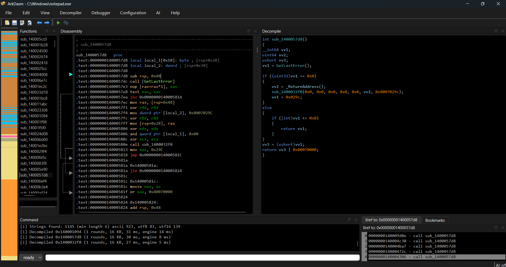
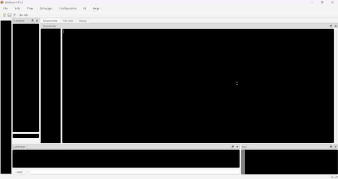

# arkDasm

arkDasm is an interactive disassembler, decompiler and debugger for 64-bit Windows executables.

**See the decompiler on a real binary:** [WindowsTerminal.exe showcase](showcase/x64Deer_WindowsTerminal.md)

## Features

- x86-64 disassembly (Zydis) with auto-generated comments and labels, jump arrows and procedure detection
- Interactive x64 decompiler, own engine (no Ghidra): rename variables, add comments, follow calls in the C view
- Local debugger: conditional breakpoints, stepping, memory snapshots, WinDbg-style commands
- Debugging on the decompiled C, no source code needed: step over and into C lines, breakpoints and Run to cursor on C lines
- Navigation: cross-references, functions, imports and exports, strings, bookmarks
- MCP server: drive arkDasm from an AI assistant, decompiled C included (read it, name its variables), and the debugger: start, step, patch and terminate the debuggee round after round, with permissions granted per group
- PDB debug symbol loading
- Save and export: project database (names, comments, bookmarks), `.asm` export, all functions as a `.c` file

## Keyboard shortcuts

### Disassembly window — Navigation

| Action | Shortcut |
|---|---|
| Jump to previous view | Esc |
| Jump to next view | \` |
| Goto address | g |
| Jump to entrypoint | Ctrl + e |
| Add bookmark | Alt + m |
| Show bookmarks | Ctrl + m |
| Decompile subroutine and switch to Decompile window | Tab |

### Disassembly window — Edit

| Action | Shortcut |
|---|---|
| Make code | c |
| Make data | d |
| Make procedure | p |
| Make byte array | Shift + 8 |
| Make ASCII string | a |
| Make UTF-16 string | w |
| Undefine | u |
| Rename | n |

### Disassembly window — Miscellaneous

| Action | Shortcut |
|---|---|
| Enter comment | ; |
| Show xref to address | x |

### Decompile window

| Action | Shortcut |
|---|---|
| Decompile function and show the Decompile window | Alt + 8 |
| Jump to the line's address in the disassembly | Tab |
| Follow symbol (decompile the called function, or show data / import in the disassembly) | Enter or double-click |
| Back to the previous function | Esc |
| Rename function, global or variable | n |
| Enter comment (shared with the disassembly) | / or ; |

Variable names are kept per function in the database; right-click → *Reset variable names in this function* gives the decompiler's names back.

### Debugger

| Action | Shortcut |
|---|---|
| Start process | F9 |
| Go | F5 |
| Step Into | F11 |
| Step Over | F10 |
| Run until return | Shift + F11 |
| Pause execution | Shift + P |
| Terminate process | Shift + F5 |
| Insert or remove breakpoint | F2 |

### Application shortcut

| Action | Shortcut |
|---|---|
| Toggle hex code on/off | F6 |
| Focus command line | F1 |

## This software uses

- [Zydis](https://github.com/zyantific/zydis) 4.1.1 — x86/x86-64 disassembler library (MIT License)
- [Qt](https://www.qt.io/) 6 — cross-platform application framework (LGPL v3)

## License

Freeware. Closed source.
